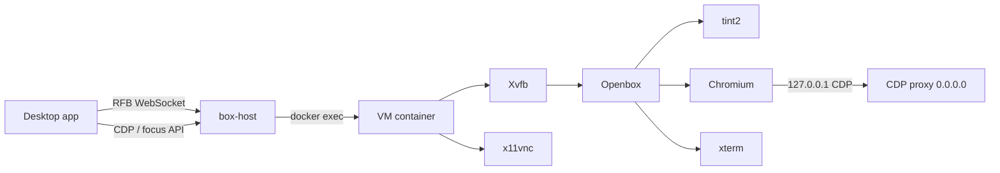

# AgentOS VM desktop

The agent “computer” is a Linux desktop inside Docker: **Xvfb** (or the host display), **Openbox**, **tint2**, **Chromium** with CDP on loopback, **xterm**, **xdotool**, and **x11vnc** for the desktop app live view.



## Build / run

```sh
docker compose --project-directory . -f infra/docker/docker-compose.yml build vm
docker compose --project-directory . -f infra/docker/docker-compose.yml up -d
```

After asset changes (`Dockerfile.vm`, `ensure-bot-browser.sh`, tint2, Chromium prefs), rebuild the `vm` image.

## Resolution

| Surface | Size | Notes |
| --- | --- | --- |
| Xvfb | `AGENTOS_SCREEN` (default `1280x800`) ×24 | Screenshots + VNC framebuffer |
| Chromium | 1280×764 at (0,0) | Leaves 36 px for tint2 |
| xterm | 100×30, iconified | Raised via desktop focus API |

Override geometry with `AGENTOS_SCREEN=1280x800` (no depth suffix).

## Env flags

| Flag | Default | Meaning |
| --- | --- | --- |
| `AGENTOS_SCREEN` | `1280x800` | Xvfb geometry |
| `AGENTOS_DISABLE_GPU` | `1` | Pass `--disable-gpu` to Chromium when not `0` |
| `AGENTOS_EGRESS_FIREWALL_HELPER` | unset | Healthcheck egress helper |

## Desktop look

- Wallpaper: solid `#1B1B1F`
- tint2: 36 px bottom bar (`/etc/agentos/tint2rc` → `~/.config/tint2/tint2rc`)
- Chromium: `Initial Preferences` from `/etc/agentos/chromium-initial-preferences.json` (about:blank, no first-run, downloads to `~/Downloads`, notifications blocked)
- Crash watchdog: if Chromium exits while the display is alive, `agentos-ensure-browser` relaunches within ~2 s

## Health

- VNC / RFB: via `ensure-bot-vnc` after a bot session starts
- CDP: `curl http://127.0.0.1:<local-port>/json/version` inside the VM
- Focus: `POST /v1/bots/:id/desktop/focus` with `{ "app": "browser" | "terminal" }`

## Troubleshooting

| Symptom | Check |
| --- | --- |
| Black screen | Xvfb / Openbox logs under `~/.agentos/browsers/`; wallpaper `xsetroot` |
| No CDP | Chromium log; SingletonLock; proxy listening on public port |
| Slow VNC | Prefer damage-based x11vnc; avoid `-noxdamage`; lower JPEG quality in watch mode |
| GPU issues | Keep `AGENTOS_DISABLE_GPU=1` in containers |

## Benchmarks

Record before/after when rebuilding:

| Metric | Target | How |
| --- | --- | --- |
| Image size | < 1.2 GB | `docker image ls` after `build vm` |
| Warm boot → healthy | < 6 s | time until CDP `/json/version` succeeds |
| Cold boot → healthy | < 20 s | fresh container + first `ensure-browser` |

Results measured 2026-11-28 (Windows Docker Desktop):

| Metric | Before | After |
| --- | --- | --- |
| Image size (`agentos/vm-manager:latest`) | 1.53 GB | 1.93 GB (live commit with tint2; clean rebuild after HTTPS Dockerfile fix still in progress / may vary) |
| Warm `ensure-browser` | — | 3152.5 ms |

## Related

- [Computer use](COMPUTER_USE.md)
- Legacy note from PR #7 polish: see git history for `docs/VM_DESKTOP.md` if present on other branches
